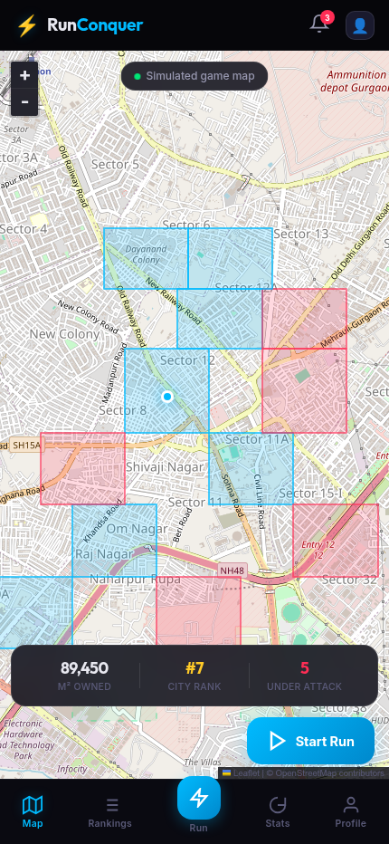
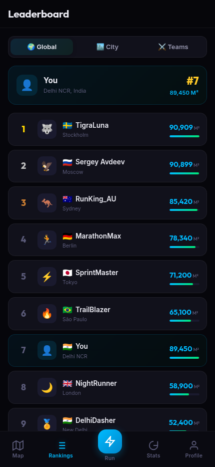

# RunConquer

<p align="center">
  
</p>

<p align="center"><strong>A territory-running game interface prototype.</strong></p>

RunConquer explores a simple idea: what if a run could capture territory on a city map? I built this mobile-first web demo to show the map, faction colors, rankings, run dashboard, stats, and player profile in one interactive interface.

## What you can try

- Explore the map and tap colored territories for their demo details.
- Switch between Map, Rankings, Run, Stats, and Profile.
- Use **Start Run** to open the run dashboard.
- Switch between global, city, and team rankings.

<p align="center">
  
</p>

## Run locally

Serve this folder with any static web server. For example:

```bash
python -m http.server 8000
```

Open <http://localhost:8000>. The app uses plain HTML, CSS, and JavaScript, plus Leaflet for the map. No build step or account is needed. An internet connection is needed for Leaflet, fonts, and OpenStreetMap tiles.

## Current scope

This repository is a **frontend demo**. Territories, rankings, achievements, profile details, and changing run numbers are simulated. The map marker moves randomly; it does not read GPS. The demo does not connect to a backend, save runs, control a watch, or support real multiplayer territory capture. The on-screen values are sample game data, not measured activity.

## Files

```text
index.html          App screens
css/index.css       Responsive visual design
js/main.js          Screen navigation
js/map.js           Leaflet map and sample territories
js/leaderboard.js   Sample ranking tabs
js/dashboard.js     Simulated run numbers
js/stats.js         Stats animation
readmeimages/       Screenshots of the running demo
```

The screenshots were captured from the locally served app at a 430 × 932 browser viewport.
